<div align="center">

<picture>
  <source media="(prefers-color-scheme: dark)" srcset="docs/media/hero-dark.jpg">
  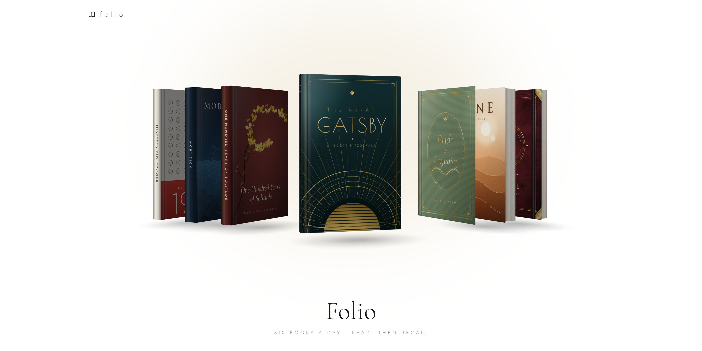
</picture>

<h3>A quiet daily shelf from a library of 1,300+ book summaries.<br><sub>Read a few each day. Then see what stayed.</sub></h3>

<p>
  
  
  
  
  
  
  
  
</p>

<p>
  <a href="https://abhinav-prabhakar.github.io/Folio/"></a>
</p>

<p>
  <a href="#a-day-with-folio"><b>Tour</b></a> &nbsp;·&nbsp;
  <a href="#the-library"><b>Library</b></a> &nbsp;·&nbsp;
  <a href="#the-quiz-book"><b>The quiz</b></a> &nbsp;·&nbsp;
  <a href="#light-and-dark"><b>Light & dark</b></a> &nbsp;·&nbsp;
  <a href="#quick-start"><b>Quick start</b></a> &nbsp;·&nbsp;
  <a href="#controls"><b>Controls</b></a> &nbsp;·&nbsp;
  <a href="docs/ARCHITECTURE.md"><b>How it's built</b></a>
</p>

</div>

<br>

Every day Folio pulls a handful of books (**six by default; you choose from three to twelve**) off a library of more than 1,300 summaries and lines them up as photo-real hardcovers. Open one and the cover swings back on its spine, then the pages lift off and settle into a large, quiet spread made for reading. The last book on the shelf is different: a leather-bound notebook called **Recall** that asks you a few questions about everything you just read. There is no score. You pick an answer, the right one is circled in ink, and you judge for yourself.

No frameworks, no build, no tracking. One `index.html`, the fonts, and a folder of Markdown summaries.

> [!NOTE]
> The library's summaries are written by **[Four Minute Books](https://fourminutebooks.com/)** (Niklas Göke) and are republished in Folio **with the author's permission**. Every summary links back to its original. If you enjoy them, [support Four Minute Books](https://fourminutebooks.com/book-summaries/).

<br>

## A day with Folio

<table>
  <tr>
    <td width="50%" valign="top">
      <b>1 · Browse</b><br>
      <sub>Drag, swipe or scroll through today's shelf. Books tilt toward your cursor and catch the light as they turn.</sub><br><br>
      <picture>
        <source media="(prefers-color-scheme: dark)" srcset="docs/media/swipe-dark.gif">
        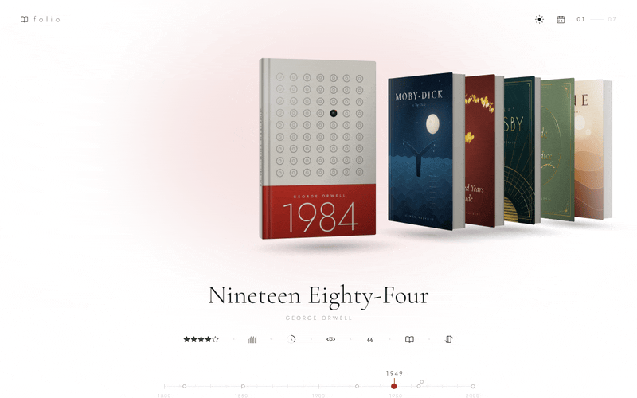
      </picture>
    </td>
    <td width="50%" valign="top">
      <b>2 · Open</b><br>
      <sub>Tap the book in front. It lifts off the shelf, the cover opens, and the pages grow into a reading spread.</sub><br><br>
      <picture>
        <source media="(prefers-color-scheme: dark)" srcset="docs/media/open-dark.gif">
        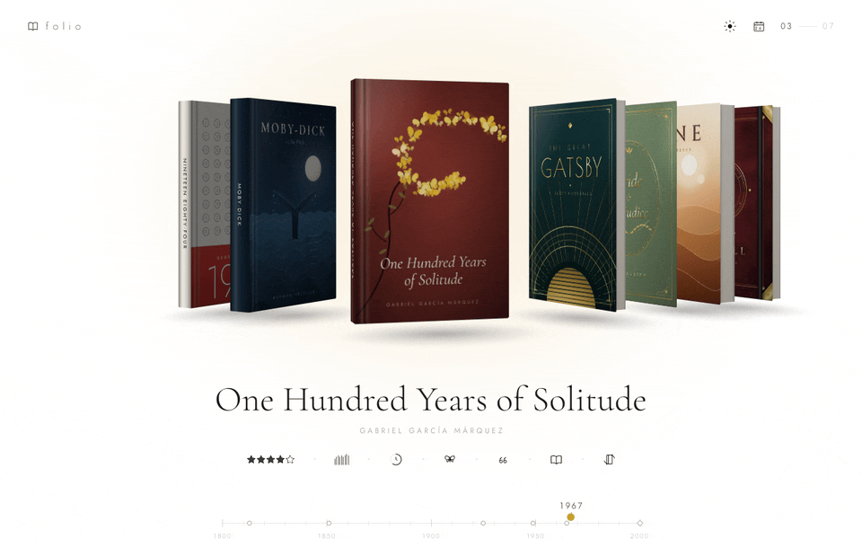
      </picture>
    </td>
  </tr>
  <tr>
    <td width="50%" valign="top">
      <b>3 · Read</b><br>
      <sub>A summary set like a well-made book: drop cap, quiet section heads, real page turns.</sub><br><br>
      <picture>
        <source media="(prefers-color-scheme: dark)" srcset="docs/media/read-dark.gif">
        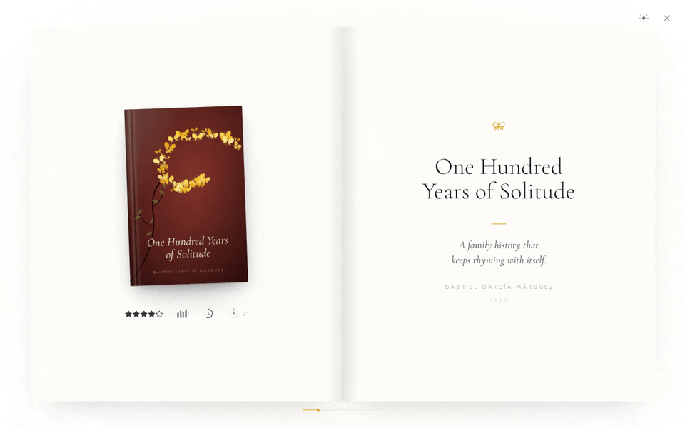
      </picture>
    </td>
    <td width="50%" valign="top">
      <b>4 · Recall</b><br>
      <sub>The quiz book asks five questions per book. Answer, and the right one is circled in ink.</sub><br><br>
      <picture>
        <source media="(prefers-color-scheme: dark)" srcset="docs/media/quiz-dark.gif">
        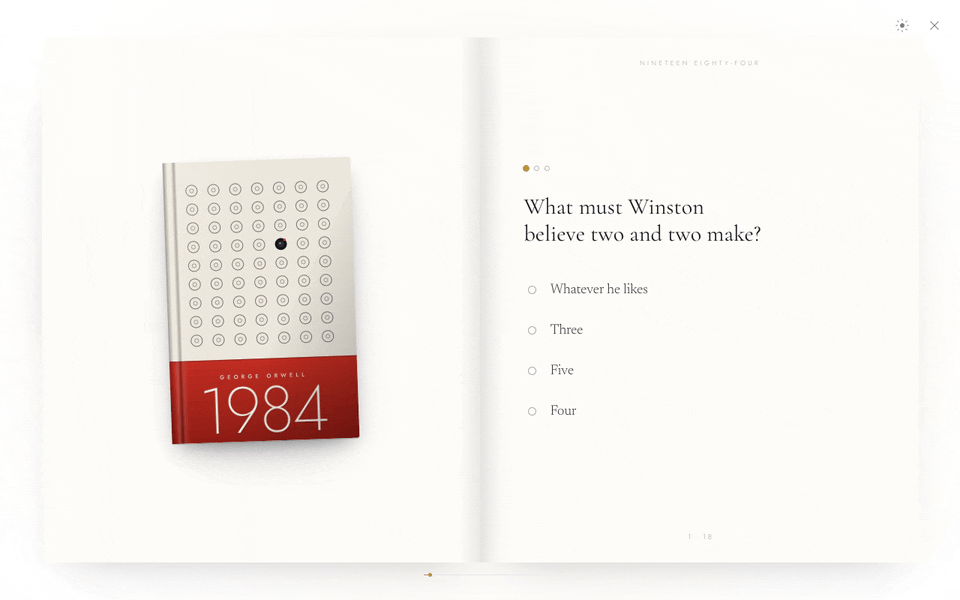
      </picture>
    </td>
  </tr>
</table>

<br>

## Made for reading

<picture>
  <source media="(prefers-color-scheme: dark)" srcset="docs/media/reading-dark.jpg">
  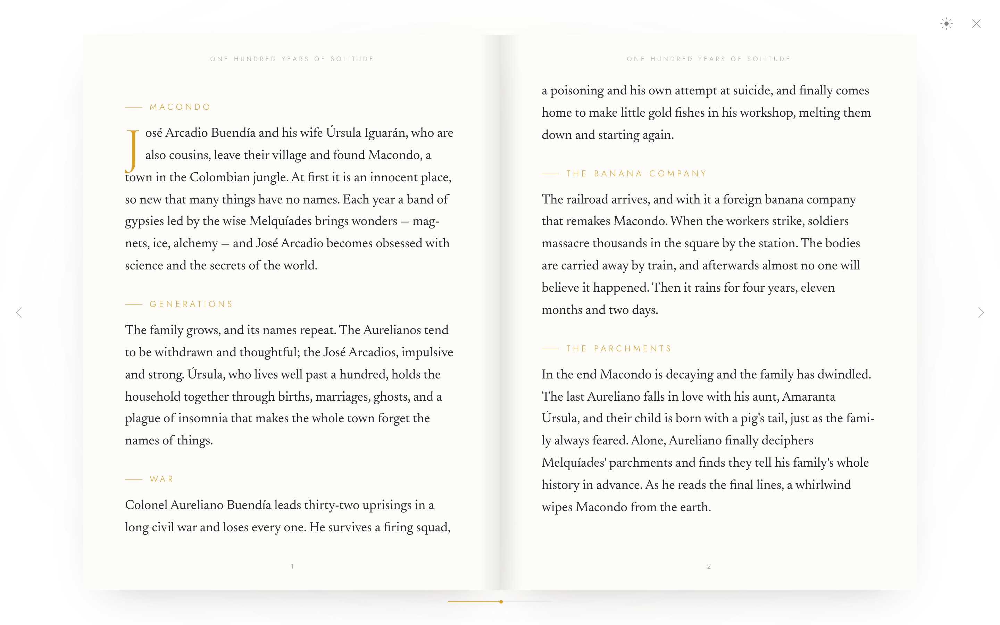
</picture>

The book is a physical object on the shelf, but once it's open, the reading comes first.

- **Big, calm pages.** On desktop the spread fills most of the screen; on a phone a single page fills the width.
- **A typeface for reading.** Body text is set in [Newsreader](https://fonts.google.com/specimen/Newsreader) at 16 to 19.5 px, with comfortable line lengths and generous leading. Titles keep the elegant [Cormorant Garamond](https://fonts.google.com/specimen/Cormorant+Garamond).
- **Proper pages, not a scroll box.** The summary is laid out into real pages, with running heads, page numbers and pages that turn on the spine.
- **The cover stays with you.** Opposite the title page sit the cover and the book's numbers as small glyphs: rating, length, reading time.

<details>
<summary><b>What's in a summary?</b></summary>
<br>

Each book has a short summary of about 400 words, written for Folio:

| Section | What it covers |
|:--|:--|
| The story | The plot, in four or five short parts |
| Characters | Who matters, one line each |
| Themes | What the book is really about |
| Why read it | One honest sentence |

Summaries are plain Markdown inside `index.html`, so they're easy to edit. See [Adding books](docs/ADDING-BOOKS.md).

</details>

<br>

## The quiz book

<table>
  <tr>
    <td width="50%">
      <picture>
        <source media="(prefers-color-scheme: dark)" srcset="docs/media/quiz-shelf-dark.jpg">
        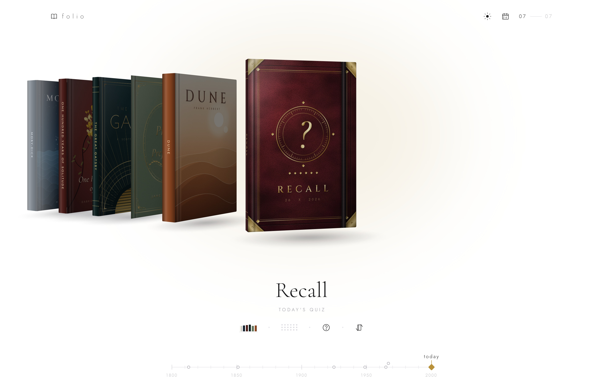
      </picture>
    </td>
    <td width="50%">
      <picture>
        <source media="(prefers-color-scheme: dark)" srcset="docs/media/quiz-answer-dark.jpg">
        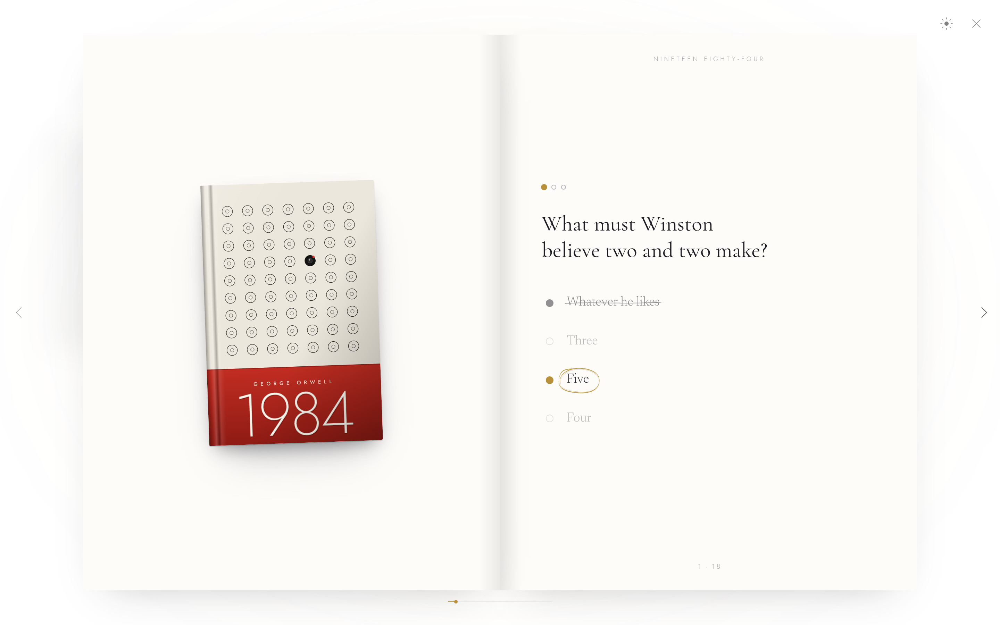
      </picture>
    </td>
  </tr>
</table>

**Recall** is always the last book on the shelf: an oxblood leather notebook with blind-debossed borders, a gilt seal, brass corner guards and an elastic band. A row of small gilt diamonds on the cover stands for today's books, one each.

- **Spaced repetition (FSRS).** Every question from every book you've finished becomes a card, scheduled with the [FSRS-5](https://github.com/open-spaced-repetition/fsrs4anki/wiki/The-Algorithm) algorithm. Recall shows today's due reviews, weakest memories first, plus a few new questions from your latest reads. A question comes back just before you'd forget it.
- **No score.** A wrong pick is struck through, the right answer gets an ink circle drawn around it, and you see when that question will come back.
- **You set the pace.** The sliders button in Recall opens *Memory*: how much to remember (80–97%), new questions a day, and the most reviews a day. You can also turn on *Rate how sure I was* (Hard / Good / Easy). Under *Advanced* sit the longest gap between reviews, the 19 FSRS parameters (paste your own from the optimizer) and a reset.
- **Where questions come from.** The eight Folio originals have theirs built in; every library book has five generated from its summary by an agent ([prompt](docs/QUIZ-AGENT-PROMPT.md)).
- **Short explanations.** Where a question comes with one, a single line under the circled answer says where in the summary it came from.

<br>

<picture>
  <source media="(prefers-color-scheme: dark)" srcset="docs/media/memory-dark.jpg">
  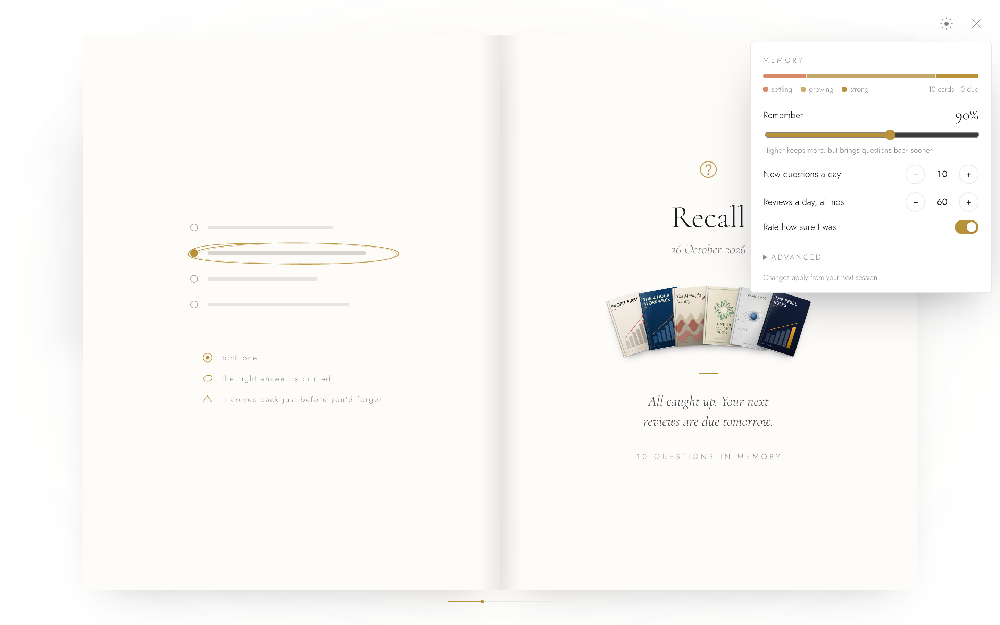
</picture>

<br>

## Light and dark

<div align="center">
  
</div>

<br>

Folio **follows your device's appearance** out of the box. The sun/moon switch in the header (also in the reader) lets you choose. The new theme spreads out in a circle from the switch, and the icon folds its rays away into a crescent.

- **Your choice sticks.** Pick the opposite of your device and Folio remembers it. Pick the same as your device and it goes back to following the device.
- **No flash on load.** The theme is set before the first paint.
- **Dark is designed too.** The shelf gets a warm glow, the reading pages turn to soft charcoal, and each book's accent colour is lifted so it stays legible. The books themselves don't change; they're objects, after all.

<table>
  <tr>
    <td width="50%">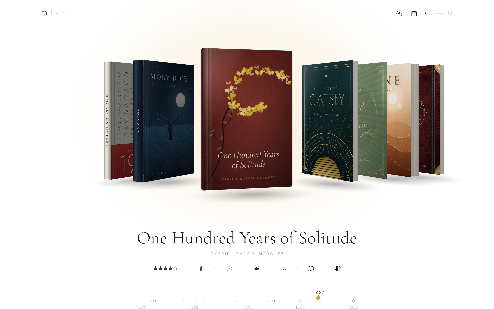</td>
    <td width="50%">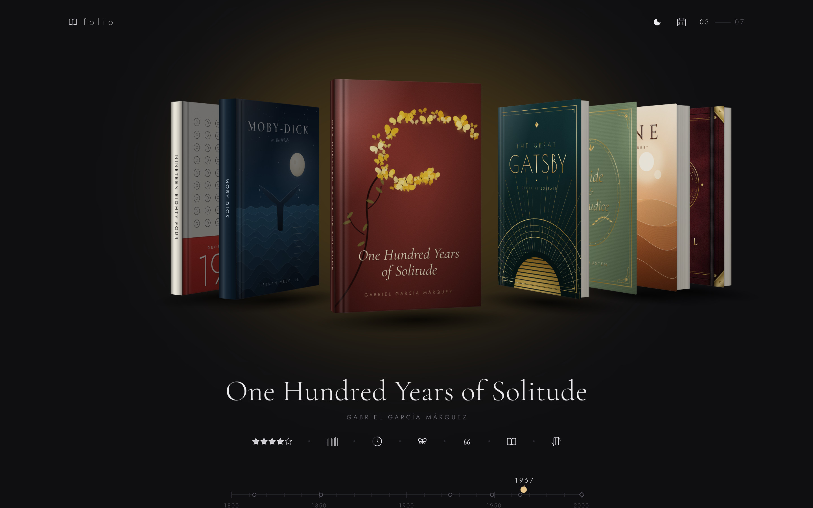</td>
  </tr>
</table>

<br>

## On your phone

<div align="center">
<picture>
  <source media="(prefers-color-scheme: dark)" srcset="docs/media/mobile-dark.png">
  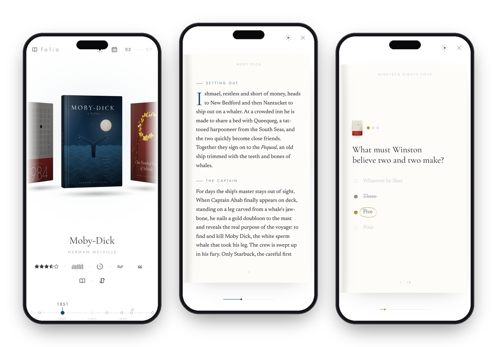
</picture>
</div>

Swipe the shelf with a thumb, tap to open, and the reader switches to one large page at a time. Tap the right side of a page to go forward, the left side to go back, or just swipe.

<br>

## Small things, tucked away

<picture>
  <source media="(prefers-color-scheme: dark)" srcset="docs/media/detail-hover-dark.jpg">
  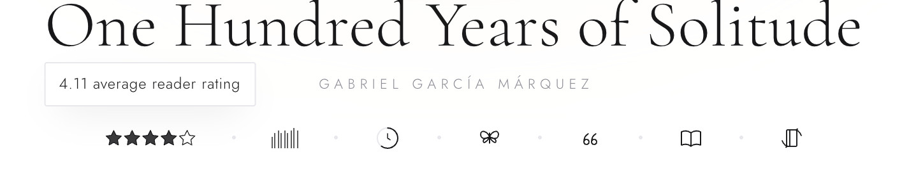
</picture>

Folio prefers a picture to a sentence, and keeps the details out of sight until you ask for them. Hover (or focus) any glyph:

| Glyph | Reveals |
|:--|:--|
| ★★★★☆ | Average reader rating |
| ǀǀǀǀǀ stack of pages | Page count |
| ◔ clock ring | Hours to read the whole book |
| genre icon | Genre |
| ❝ quote mark | The book in one line |
| author name | Years and birthplace |
| timeline dot | Title, placed by year of publication |
| calendar | Hours until tomorrow's shelf |

You can also **turn a book over** to read its back cover, with the blurb and a barcode.

<br>

## The library

<picture>
  <source media="(prefers-color-scheme: dark)" srcset="docs/media/library-grid-dark.jpg">
  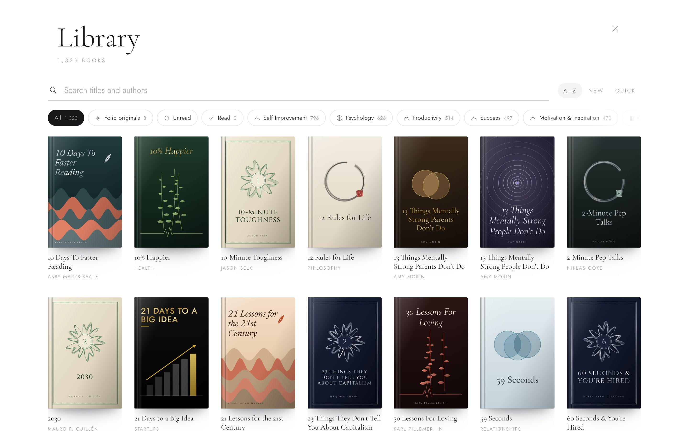
</picture>

The library button in the header (or <kbd>/</kbd>) opens **every book Folio knows**: 1,300+ summaries from Four Minute Books plus Folio's eight originals.

- **Search** titles, authors and categories as you type.
- **Filter** by any of 44 categories, or show just the Folio originals.
- **Sort** alphabetically, by newest, or quick reads first.
- **Open any book.** It flies from its tile into the same reader as the daily shelf, and the summary loads on demand.

<br>

<picture>
  <source media="(prefers-color-scheme: dark)" srcset="docs/media/library-open-dark.gif">
  
</picture>

<br>

### A cover for every book

<div align="center">
  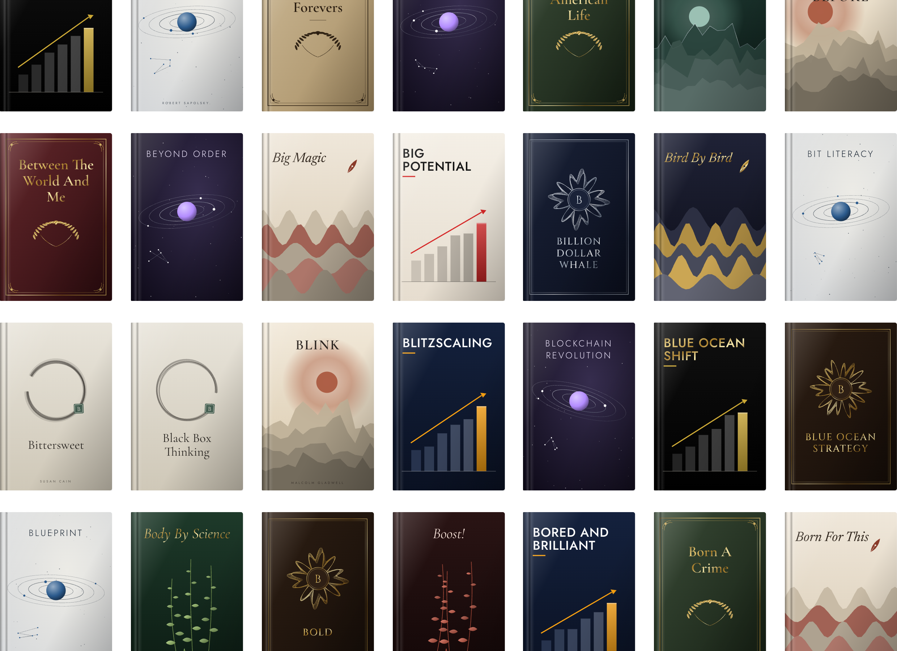
</div>

<br>

Library covers are **generated**, but they're made the same way as the hand-drawn ones: foil gradients, embossed lettering, glow and texture. Each book's subject picks one of ten families, and its id picks the palette and layout, so a book always looks the same and neighbouring books never match.

| Family | Subjects | Motif |
|:--|:--|:--|
| Ascent | self-improvement, success, productivity, career, leadership | layered peaks under a low sun |
| Mind | psychology, mental health, mindfulness, happiness | ripples from a single drop |
| Ledger | money, investing, economics | banknote guilloché rosette |
| Venture | business, startups, marketing, sales, management | art-deco bars and a rising arrow |
| Archive | history, politics, biography, culture | cloth binding, gilt frame, laurel |
| Cosmos | science, technology, future, environment | star map and tilted orbits |
| Vital | health, fitness, nutrition | botanical stems and a pulse line |
| Sage | philosophy, spirituality, religion | ink ensō and a red seal |
| Bonds | relationships, parenting, communication | overlapping rings |
| Quill | creativity, writing, education, fiction | layered paper-cut waves and a nib |

<details>
<summary><b>The eight Folio originals</b></summary>
<br>

<div align="center">
  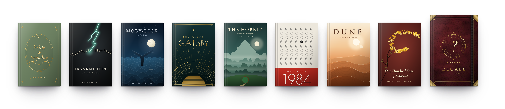
</div>

| | Book | Author | Year |
|:-:|:--|:--|:-:|
| 1 | Pride and Prejudice | Jane Austen | 1813 |
| 2 | Frankenstein | Mary Shelley | 1818 |
| 3 | Moby-Dick | Herman Melville | 1851 |
| 4 | The Great Gatsby | F. Scott Fitzgerald | 1925 |
| 5 | The Hobbit | J.R.R. Tolkien | 1937 |
| 6 | Nineteen Eighty-Four | George Orwell | 1949 |
| 7 | Dune | Frank Herbert | 1965 |
| 8 | One Hundred Years of Solitude | Gabriel García Márquez | 1967 |

Hand-drawn covers, summaries written for Folio, and built-in quiz questions.

</details>

### Your daily shelf

Tap the **calendar** in the header to choose how many books you get each day, from three to twelve. **Books never repeat:** each new day draws only from books you haven't been shown or read, until you've been through the whole library. Reaching a summary's last page marks it **read**: the library gives it a gilt seal and has *Read / Unread* filters, and its questions join your reviews.

<br>

## Quick start

**Use the live site:** <https://abhinav-prabhakar.github.io/Folio/>. It installs as an app (PWA) and keeps working offline for books you've opened.

**Or run it locally.** Serve the folder, because browsers don't let a page opened as a local file load the library:

```bash
python3 -m http.server 8000
```

Then visit <http://localhost:8000>.

> [!TIP]
> **Hosting your own copy?** Fork the repo, enable *Settings → Pages → Deploy from a branch* (`main`, root folder), then update the `og:url`, `og:image`, `twitter:image` and `canonical` addresses in `index.html` so link previews point at your site.

<br>

## Controls

| | Mouse & keyboard | Touch |
|:--|:--|:--|
| **Browse the shelf** | Drag, scroll, <kbd>←</kbd> <kbd>→</kbd>, or click a timeline dot | Swipe |
| **Open a book** | Click the front book, press <kbd>Enter</kbd>, or the open-book glyph | Tap the front book |
| **Turn a book over** | <kbd>Space</kbd> or the turn-over glyph | Turn-over glyph |
| **Turn pages** | <kbd>→</kbd> <kbd>←</kbd>, <kbd>Space</kbd>, <kbd>Page Up</kbd>/<kbd>Page Down</kbd>, or click a page | Tap the page sides, or swipe |
| **Answer a question** | Click an answer | Tap an answer |
| **Close the book** | <kbd>Esc</kbd>, the ×, or click outside the book | ×, or tap outside the book |
| **Switch theme** | Sun/moon switch in the header or reader | Same |
| **Open the library** | Library button, or <kbd>/</kbd> to jump straight to search | Library button |
| **Books a day** | Click the calendar, then − / + | Tap the calendar |

Folio respects **Reduce Motion**: if it's on in your system settings, transitions become instant.

<br>

## Under the hood

<table>
  <tr>
    <td width="33%" valign="top"><b>One file</b><br><sub>HTML, CSS and vanilla JavaScript in <code>index.html</code>. No framework, bundler or package manager needed to run it.</sub></td>
    <td width="33%" valign="top"><b>Real 3D, real light</b><br><sub>Each book is six CSS 3D faces. A light model shades every face as it turns, with glare, grain, cloth and spine highlights layered on top.</sub></td>
    <td width="33%" valign="top"><b>Covers as code</b><br><sub>Every cover is generated SVG: gradients, embossed foil, turbulence textures. Crisp at any size, with nothing to download.</sub></td>
  </tr>
  <tr>
    <td valign="top"><b>True pagination</b><br><sub>Summaries flow through CSS columns sized to the page, so they break into pages the way a typesetter would.</sub></td>
    <td valign="top"><b>Seeded days</b><br><sub>The date seeds a small random generator that picks the shelf and the quiz, so a day is the same for everyone, with no server.</sub></td>
    <td valign="top"><b>Theme tokens</b><br><sub>Colours are design tokens with a separate palette for pages. Theme changes use the View Transitions API, with a crossfade where that isn't supported.</sub></td>
  </tr>
</table>

<details>
<summary><b>Project layout</b></summary>
<br>

```text
Folio/
├── index.html              the whole app: markup, styles, covers, cover generator, reader, quiz, logic
├── sw.js                   service worker: offline shell, cached summaries and fonts
├── site.webmanifest        install metadata (name, colours, icons)
├── data/
│   ├── catalog.json        every library book: title, author, year, categories, hook, lessons, link
│   ├── summaries/          one Markdown file per summary (Four Minute Books, with permission)
│   └── quiz/               question files per book + index.json (written by the quiz agent)
├── assets/
│   ├── favicon.svg         gold open-book mark on oxblood
│   ├── favicon-32.png
│   ├── apple-touch-icon.png
│   ├── icon-192.png
│   ├── icon-512.png
│   └── og.png              1200×630 social card
├── docs/
│   ├── ARCHITECTURE.md     how the shelf, reader, quiz and theming work
│   ├── ADDING-BOOKS.md     add a book: data, cover, summary, questions
│   ├── LIBRARY.md          how the library is built, refreshed and credited
│   ├── QUIZ-AGENT-PROMPT.md  the prompt that writes the library's quiz questions
│   ├── MEDIA.md            regenerate the screenshots, GIFs and icons
│   └── media/              images used in this README
├── tools/
│   ├── catalog/            scrape.mjs + enrich.mjs: builds data/ from Four Minute Books and Open Library
│   ├── quiz/               build-index.mjs: validates quiz files and writes the index
│   └── media/              capture scripts (Puppeteer + gifski)
└── .github/workflows/      refresh-library.yml: weekly library refresh
```

</details>

<details>
<summary><b>Browser support</b></summary>
<br>

Built for current versions of Chrome, Edge, Safari and Firefox on desktop and mobile. Two features degrade gracefully:

- **View Transitions** (the circular theme reveal): where it isn't supported, the theme crossfades instead.
- **Local storage** (today's answers, theme choice): if a browser blocks it, for example in some private modes, Folio still works but forgets your answers when you close the tab.

Fonts come from Google Fonts. Offline, Folio falls back to system serif and sans-serif faces.

</details>

**Go deeper:** [Architecture](docs/ARCHITECTURE.md) · [The library](docs/LIBRARY.md) · [Quiz agent prompt](docs/QUIZ-AGENT-PROMPT.md) · [Adding books](docs/ADDING-BOOKS.md) · [Regenerating media](docs/MEDIA.md)

<br>

## Credits

- **Typefaces:** [Cormorant Garamond](https://fonts.google.com/specimen/Cormorant+Garamond), [Newsreader](https://fonts.google.com/specimen/Newsreader), [Jost](https://fonts.google.com/specimen/Jost), [Cinzel](https://fonts.google.com/specimen/Cinzel) and [Poiret One](https://fonts.google.com/specimen/Poiret+One), via Google Fonts.
- **Library summaries:** [Four Minute Books](https://fourminutebooks.com/) by **Niklas Göke**, republished in Folio with the author's permission. Every summary credits and links to its original on fourminutebooks.com. The summaries remain Four Minute Books' work; please don't reuse them from this repository without their permission.
- **Authors and publication years** for library books come from [Open Library](https://openlibrary.org/) (Internet Archive).
- **Covers** are original to Folio: eight hand-drawn, the rest generated. **The eight original summaries** and their quiz questions were written for Folio. Book titles and author names belong to their respective rights holders; no publisher cover art is used.
- **Reader ratings** are approximate public averages and are shown for flavour only.

<br>

<div align="center">
  <br>
  <sub>Made with care for slow, daily reading.</sub>
</div>
