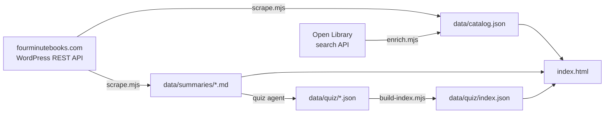

# The library

How Folio's library of 1,300+ summaries is built, kept up to date and credited.

[← Back to the README](../README.md)

---

## Credit and permission

The library summaries are written by **Niklas Göke** for **[Four Minute Books](https://fourminutebooks.com/)**. They're republished in Folio **with the author's permission**, on condition that they're credited. Folio credits them:

- on each summary's title page ("N-minute summary · Four Minute Books", linked to the original),
- on the page facing the title ("Summary by Four Minute Books ↗"),
- at the end of every summary,
- under each library book on the shelf (author tooltip, plus a glyph linking to the original),
- in the library footer, the README and `data/catalog.json` (`credit` field).

Keep these in place. The summaries remain Four Minute Books' work.

## Pipeline



### 1. Scrape: `tools/catalog/scrape.mjs`

- Reads the site's public WordPress REST API in pages of 100 (about 14 requests), with a pause between requests and an identifying user agent. Robots.txt allows crawling.
- Keeps posts whose URL ends in `-summary/`. Book lists, quote collections and reviews are skipped.
- Converts each post's HTML into the Markdown Folio's reader understands:

| Source | Becomes |
|:--|:--|
| "1-Sentence-Summary: …" | the hook under the title (`> …`) and `h` in the catalog |
| "Read in: N minutes" | `m` in the catalog |
| Intro paragraphs | `## Overview` |
| "Lesson N: headline" | `## Lesson N` + `### headline`, and `l` in the catalog |
| "… Review" | `## Review` |
| "Who would I recommend …" | `## Who it's for` |
| Other headings | `### heading` |
| Lists, bold, italics, quotes | kept |
| Links | plain text |
| Quote images, PDF/audio promos, newsletter forms, video embeds, buttons, scripts | dropped |

- Writes `data/summaries/<id>.md` (id = slug without `-summary`) and `data/catalog.json`.

### 2. Enrich: `tools/catalog/enrich.mjs`

Four Minute Books doesn't publish book authors as data, so each title is looked up in the [Open Library search API](https://openlibrary.org/dev/docs/api/search). A candidate is accepted only if its title closely matches **and** its author's surname actually appears in that book's summary, so wrong matches are rare. Results, including misses, are cached in `tools/catalog/openlibrary-cache.json`, so refreshes only look up new books. This adds `a` (author) and `y` (first-publication year, used by the timeline).

### 3. Quiz questions

Written by an agent from each summary; see [QUIZ-AGENT-PROMPT.md](QUIZ-AGENT-PROMPT.md). `tools/quiz/build-index.mjs` validates the files and writes `data/quiz/index.json`, and the app only requests question files listed there.

### 4. Weekly refresh

`.github/workflows/refresh-library.yml` runs every Monday, and on demand from the Actions tab. It scrapes, enriches, re-indexes the quiz, and commits any changes. GitHub Pages redeploys automatically.

Run it locally:

```bash
cd tools/catalog
npm install
npm run scrape          # then:
node enrich.mjs
node ../quiz/build-index.mjs
```

## `data/catalog.json`

```jsonc
{
  "source": "https://fourminutebooks.com/book-summaries/",
  "credit": "Summaries by Four Minute Books (Niklas Göke), fourminutebooks.com. Republished with permission.",
  "base": "https://fourminutebooks.com/",
  "updated": "2026-10-26",
  "cats": ["Self Improvement", "Psychology", …],          // by frequency
  "books": [{
    "s": "atomic-habits-summary",   // slug on fourminutebooks.com
    "t": "Atomic Habits",           // title
    "a": "James Clear",             // author (Open Library or the site's SEO title; may be "")
    "y": 2018,                      // first published (Open Library; may be missing)
    "c": [0, 1, 25],                // indexes into cats
    "h": "Atomic Habits is …",      // one-sentence hook
    "m": 4,                         // minutes to read
    "l": ["Every time we …", …],    // lesson headlines
    "w": 1650,                      // words in the converted summary
    "d": "2018-11-05"               // date added to Four Minute Books
  }]
}
```

## In the app

- **Startup** fetches `data/catalog.json` (about 600 KB, cached by the service worker) and turns each entry into a book. Catalog copies of the eight Folio originals are skipped.
- **Daily picks** come from the whole library: `shuffle(all books, seed = date + count)`, then the first *N* (3–12, default 6, set from the calendar).
- **Covers** are generated by `genCover()`, described in [ARCHITECTURE.md](ARCHITECTURE.md#generated-covers).
- **Summaries** load on demand from `data/summaries/<id>.md`, and the service worker caches each one after its first open.
- **Opened from a local file** (`file://`), browsers block these requests. The shelf then falls back to the eight originals, and the library says so.
